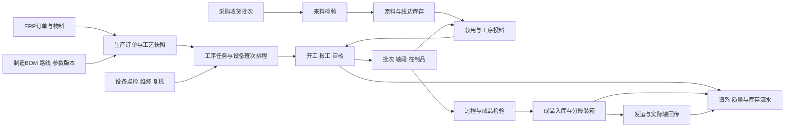

# Cadenza 领域模型与业务一致性设计

版本：规划 v0.1｜2026-10-27｜上位范围：[产品合同](PRODUCT_CONTRACT.md)

本设计将原 PRD 中分散在页面里的规则收敛为领域合同。以下是新系统的目标模型；对原文语义的纠正明确登记在 [PRD 问题归并](../requirements/PRD_ISSUES.md)，不能伪装成已经批准或已经实现。

## 1. 从业务对象到完整生产链

箭头表示业务依赖，不意味着每个节点都部署为服务。实物移动、库存记账、质量判定和外部同步分别有状态。

## 2. 领域与数据写入责任

| 领域 | 核心聚合及建议数据对象 | 写入责任和边界 |
| --- | --- | --- |
| 组织与权限 | enterprise、legal_entity、plant、department、work_center、person、role、scope_grant、shift_calendar | 每个业务事实有组织与工厂；组织树变更不回写历史快照；业务命令在服务端核权 |
| 工厂主数据 | material、uom、conversion_revision、equipment、warehouse、location、rack、external_mapping | 每个字段明确主系统；被引用资料失效或新版本替代，不级联删除业务历史 |
| 工艺工程 | product_family、manufacturing_bom_revision、route_revision、operation_definition、parameter_spec_revision、work_instruction_revision | 草稿→审核→发布→失效；发布版本冻结，订单引用具体版本 |
| 订单与调度 | production_order、order_revision、order_operation、dispatch、schedule_slot、capacity_calendar | 订单状态、工序就绪、派工与排程分离；同一排程事实投影到订单和设备视图 |
| 执行 | execution_session、production_report、report_output、material_consumption、labor_record、handover | 报工与单独投料独立业务命令；通过工序执行实例关联，避免一张大单包揽全部过程 |
| 轴段与谱系 | material_lot、inventory_unit、material_segment、carrier、carrier_binding、customer_segment、genealogy_edge | 实物身份与客户标识分离；记录拆分、合流、换轴、报废和客户归属变更 |
| 库存物流 | stock_transaction、stock_entry、stock_balance、reservation、receipt、putaway_task、transfer、stocktake、shipment、carrier_loan | 库存域唯一维护数量、库位、所有权和预留；其它领域通过库存命令进入同一事务 |
| 质量 | inspection_plan_revision、inspection_order、sample、test_result、disposition、quality_hold、certificate | 检验事实与有效判定分开；放行、复检、让步及撤销保留关联和审批 |
| 设备维护 | asset、maintenance_plan、inspection_round、maintenance_order、downtime_event、spare_part_usage、calibration_record | 设备状态是投影；维护停机与生产运行事实共同形成可用能力 |
| 业务协同 | purchase_receipt_batch、price_review、allocation_change、packing_order、integration_job | 采购复核不变更质量；形态转换不伪造物理产出；同步任务不直接越域改表 |
| 分析 | metric_definition_revision、shift_snapshot、cost_allocation、energy_allocation、read_projection | 指标只读业务事实；重建投影不能重新执行报工或扣库存 |
| 平台 | command_receipt、business_event、outbox、inbox、audit_entry、attachment_revision、print_job | 记录幂等、追踪与技术执行；不让通用工作流引擎决定产品数量和质量 |

建议实体名用于明确职责，不是本次已建数据库或最终 DDL。工程阶段按领域逐块落库，跨域公开命令与查询合同稳定后再细化表结构。

## 3. 身份与组织模型

### 3.1 多组织与多工厂

采用 `enterprise_id → legal_entity_id → plant_id → department/work_center` 的业务归属。集团只读汇总不等于跨工厂写权限。外部主键使用 `source_system + organization_code + object_type + external_id + line_no`，不能仅凭 U9 料号或订单号去重。

单客户私有化是首期部署形态。跨客户 SaaS、计费和共享数据库不进入首期；企业命名空间与工厂权限从第一期建好，避免把“公司组织”误当成“租户”。多厂数据是否集中部署见 [系统架构](SYSTEM_ARCHITECTURE.md)。

库存的法律／业务所有者与保管工厂、所在库位分开。客供料、寄存物和客户轴盘沿用实际所有者；载具借出、回收、损坏与报废有独立记录，不能把客户轴盘回收当成产品退货。相关能力属于原 PRD 的显式补充。

### 3.2 线缆身份分层

| 身份 | 含义 | 变化方式 |
| --- | --- | --- |
| 物料批次 MaterialLot | 供应商批次或生产批次，包含牌号、线径、来源等 | 不可覆盖历史；生产形成新批次并保留输入边 |
| 库存单元 InventoryUnit | 同一物料、批次、质量归属下可以计量和流转的一份库存 | 可拆分、消耗或转移；保留内部唯一 ID |
| 轴段 MaterialSegment | 指定产品在某个生产结果中的连续长度范围或独立段 | 分盘建立子段；无法可靠测得区间时标“数量追溯”，不能声称米级定位 |
| 实物载具 Carrier | 轴盘、周转轴、托盘、箱等可复用容器 | 通过带生效时间的绑定关系装载库存单元；清空仅解除当前装载 |
| 客户轴段 CustomerSegment | 合同要求的客户轴号、段长、虚拟轴号与交付分段 | 由合同版本及具名修正调整；保留原分配关系 |
| 标签 BarcodeLabel | 物料码、产品轴码、托码、设备码和库位码的识别媒介 | 补打引用原对象；作废与重印有记录；扫描格式不是数据库主键 |

PRD 中存在“一码多物”和同一码多次收货的场景。模型使用 `barcode → binding → inventory_unit`，扫码解析返回候选业务对象，再按具体任务选择；倒轴等不支持一码多物的命令应显式拒绝，不能任取第一条。

原有 `EQU-`、10 位载具码及工厂／货架码格式作为条码适配规则，按版本校验。新旧格式映射有唯一性检查；客户轴号重用不复用内部实体 ID。

## 4. 工艺、数量与物料平衡

### 4.1 工序需求与版本

原 [生产订单 PRD §2.1 工序设置](../requirements/source/PRD文档/生产管理/生产订单.md)定义：末道下线需求由订单数量、芯倍数和绞合系数推导，上游工序从下游需求递推。Cadenza 保留这一计划意图，同时明确单位和版本：

`本工序计划需求 = 下游需求 × 本工序芯倍数 × 本工序绞合系数`，只在适用工艺和同一计算口径内使用。新增的损耗／余量参数必须独立命名、受版本控制，不能偷偷并入绞合系数。

例如一个教学性样本：成品需求 1,000 m，某工序需要 3 股、系数 1.02，其上游计划线长为 3,060 m。这个结果只用于备料和排程，不会在库存账上生成 3,060 m；实际库存必须来自收货或经审核的实际产出。真实公式由该产品族工艺验证。

订单下达时保存 BOM、路线、系数、预计速度、换算、检验规范和客户分段快照。已有报工后，更改芯倍数、绞合系数或下线量应形成变更版本和未执行任务调整；已完成实绩保留原版本。分支工序和多芯汇合使用明确前后依赖，首期可先实现 PRD 的顺序路线，扩展时不改变历史对象身份。

### 4.2 计量原则

- 数量以十进制定点处理，接口传十进制字符串；业务规则约束小数位。原 PRD 常见 4 位小数，应保留；数据库可存更高精度，但显示舍入不改账。
- 保留 `quantity + uom + measurement_basis + conversion_revision`。米／千米、千克／吨分别精确换算；米与千克依物料规格、理论米重或实际测量，不使用全局固定换算。
- 采购包装换算引用后不可改，沿用原 PRD 意图；变化产生新版本。计量器具、采样时间、人工／设备来源随实测记录保存。
- 件数、盘数、托数属于离散计数，与长度／重量不能互相覆盖。订单超产比例在服务端按同单位检查，不仅在界面提示。
- 同物料倒轴／分盘：`原量 = 子段量合计 + 留存量 + 已记录损耗量`。数量为零的单元关闭活动余额，身份和谱系仍保留。
- 多芯合流或工艺形态改变不要求输入与输出“米数相等”；按 BOM、芯数、材料重量及工艺收率核对。投入、在制、产出、废料、返料和回收各有去向。

### 4.3 原材料与半成品消耗

原《单独投料》主要描述前道半成品消费，不能据此宣称原料全过程已经覆盖。新系统补齐原料领用、退料、投料、辅料消耗、余料回仓、废料回收；自动倒冲仅在工艺明确允许时使用，标明估算与实耗，差异由盘点或结料调整。

投料时按实时库存校验并扣减，记录扣前／扣后余额，不采用 PDA 扫码时的旧值。跨订单投料除保留原确认动作，还须核对物料规格、质量、客户限制和授权，形成谱系与成本归属；不能只弹一次确认就绕过业务限制。

替料和混批按工艺／质量授权形成偏离记录，保留批准范围、原配方与实际投料；不能直接改 BOM 掩盖实耗。外协工序作为 G4 扩展，以外协任务关联发送、在外加工、回厂接收及检验，保留材料所有权和供应方加工事实；沿用库存交接与质量合同，商务结算归 ERP。

## 5. 状态机与生效时间

| 对象 | 主要状态轴 | 关键约束 |
| --- | --- | --- |
| 生产订单 | 已接收／已核准→允许开工→进行中→完工待核→已结束；挂起、作废独立处理 | ERP 商业关闭与 MOM 执行完成分开；缺工艺、映射或授权不能开工 |
| 工序任务 | 未就绪→就绪→已派工→执行中→待检／待核→完成；暂停／返工 | 按前置工序、物料、设备与质量规则就绪，不能只判断“前道出现过一张报工单” |
| 报工 | 草稿→已提交；审核轴为待审／自动通过／人工通过；更正／冲销关联原单 | 草稿数、提交数、审核数、合格数、入库数分别展示；不可混成一个完成量 |
| 质量 | 待检／免检／合格／不合格／待复检；隔离与处置独立 | “审核通过”不等于“质检合格”；让步放行保留原不合格事实 |
| 库存 | 在库／在制／在途／已发运／已耗尽；预留、隔离、任务占用另记 | 可用量只由满足质量和预留条件的余额形成；同一码不能多任务同时消费 |
| 调拨 | 草稿→待执行→出库中→已出库在途→收货中→完成 | 同仓移库单独处理；跨厂收货需要接收方事实，不默认替代签收 |
| 形态转换 | 待执行／外部处理中／本地处理中／完成／待恢复／人工处理 | 对象业务状态和外部同步状态分离，保留外部未知结果 |
| 维修工单 | 已报修→分派→处理中→待复机→关闭；取消另记 | 关闭须结果与责任人，复机更新可用性并触发计划评估 |

物流报工的特殊路径沿用其“物流动作”意图，但不制造第二份制造产出；将原文的物流报工入口连接到入库任务。具体兼容字段在 G0 合同中绑定，不让“自动审核”绕过订单、质量和库存校验。

班次日期由工厂日历、时区和白班起点计算；同时保存实际时间与业务班次。跨午夜、补录、时钟偏差及订单开工时间不同都应可解释，不能把订单开工时间当作每张报工的开工时间。

## 6. 事务与并发的明确边界

| 命令 | 一次数据库事务内必须完成 | 可异步的结果 |
| --- | --- | --- |
| 确认采购收货 | 批次／明细、实物身份、库存流水、初始质量状态、订单行实收投影、命令结果、Outbox | 向 ERP 通知、查询统计与通知 |
| 提交／审核报工 | 生效状态、产出单元、业务数量、库存／待检归属、谱系、命令结果、Outbox；未到生效点只记对应状态 | 成品检验待办投影、对外产出回传、分析 |
| 单独投料 | 按稳定次序锁库存单元、校验实时可用量、扣减、消耗记录、谱系、事件、Outbox | SAP／ERP 投料回传和库存统计投影 |
| 倒轴／分盘／分托 | 校验所有来源和目标、调整余额或绑定、保留前后关系、审计和事务事件 | 标签打印、查询投影 |
| 调拨出库／接收 | 每一步分别原子化：来源减少与在途增加；在途减少与目的入库；单据进度同步 | 外部通知与集团分析 |
| 确认成品出库 | 全部明细满足、质量与预留校验、出库状态、库存减少、发运事实、Outbox | 实际轴同步、发货状态同步分别处理 |
| 撤销／冲销 | 校验下游引用和对象版本，写反向流水、新的纠正事实、影响结果及审计 | 对外冲销、分析更新 |

库存记账由库存域执行，其应用接口可以加入上层命令的同一 Unit of Work。域边界不等于强行分库，也不允许其它模块随手更新 `stock_balance`。业务事务不跨公网等待 ERP。

使用唯一约束、预期版本及必要的行锁保护库存、客户轴段分配和未完成作业；前端按钮防连点只改善体验。跨行约束可用适当的事务隔离及有界重试，不能把所有业务都无条件升级到全库串行。

分托等长作业采用可恢复的“作业预留”，包含所有者、占用对象、有效期和释放记录；过期后旧终端提交必须重新校验。库存最终确认仍在数据库事务内完成，不能把 Redis 锁或手机本地缓存当成最终依据。

## 7. 两种形态转换分别恢复

### 7.1 订单形态转换

按原《订单形态转换》，同料品订单间的实物归属先由现场扫码完成，再异步推送 U9。目标流程为：校验并预留→本地归属调整与库存维度转账→写外发任务→U9 确认。外部失败时保留本地已执行事实和待同步差异，不重复做本地转换；在商业约束未闭合期间，涉及发运的使用按业务策略隔离。

### 7.2 库存形态转换

按原《库存形态转换》，先取得 U9 成功，再修改 MOM 归属。目标流程为：创建转换意图并预留源库存→发送外部请求→明确外部成功→本地事务改归属／客户字段→完成。U9 已成功、本地失败时只重试本地应用；网络超时且结果未知时先查询外部流水，不能盲目再发。

原文明确“转换后项目号记单据、不回写码项目号”，在兼容映射中保留。外部接口成功状态、业务单据状态、库存投影状态分别存储；不要以原 UI 的“首次默认转换失败”作为内部状态机。

对于外部系统缺少幂等键或结果查询的接口，超时进入人工核对，不声称已实现恰好一次。重试日志需能识别外部单号、请求摘要、关联命令及实际结果。

## 8. 更正、作废与追溯

原 PRD 有清空码、管理删除采购批次、覆盖检验结论等能力。新系统保留“纠正错误”的用户目的，但已入账事实采用作废、冲销和新版本；已形成追溯的事实不物理删除。普通草稿可以删除，仍保留必要操作记录。

- 任一产出已经入库、被消耗、转换、发运或形成生效质量结果，就不能直接取消原审核。必要时走具名下游逆序冲销或质量处置流程。
- 轴号修正不能自动抢走他人已使用的客户轴号；冲突先展示占用与影响，符合规则且有权限时执行显式重新分配。
- 盘点、截取、成品异常扣数必须对应调整原因和去向。零余额可关闭，谱系节点不删。
- 正向追溯回答“这批原料去了哪些在制、轴段、客户交付”；反向追溯回答“这根交付轴由什么料、哪些工序、设备、人员和质量结果产生”。
- 追溯精度按证据分为批次、库存单元、轴段／区间。没有连续计长、位置标记或可靠分段关联的场景，不承诺任意一米的精确定位。

## 9. 三个贯穿验证样例

1. **余量竞争：**库存单元剩余 100 m，两个 PDA 分别提交 70 m、50 m。最多一个请求可按原量成功，另一个得到可解释冲突；账上不得出现 -20 m，重试不重复扣减。
2. **分盘与修正：**1,000 m 的同物料轴分为 600 m、390 m、10 m 已登记损耗，三种去向合计一致；若 600 m 子轴已发运，回撤原倒轴必须受阻，不能直接恢复父轴 1,000 m。
3. **接口半成功：**U9 已批准库存形态转换，MOM 写入前进程退出；恢复只应用同一转换的本地事务，外部单据不新增第二张，库存与客户分段关系最终可对账。

这些样例定义要证明的行为。本次未运行产品测试，也未启动严格 TDD。
