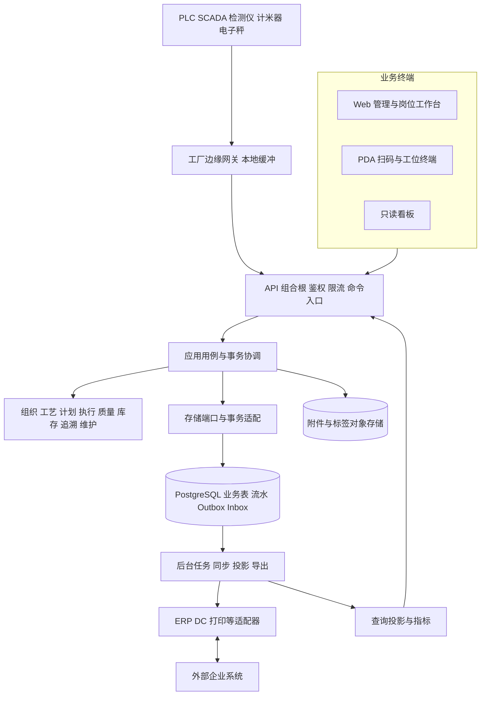

# Cadenza 系统架构与技术建设方案

版本：规划 v0.1｜2026-10-27｜业务边界：[产品合同](PRODUCT_CONTRACT.md)｜数据语义：[领域模型](DOMAIN_MODEL.md)

**采用模块化单体作为交易核心，配独立后台任务进程和工厂边缘接入。** 报工、库存、质量、轴段归属等强关联事实先在 PostgreSQL 内可靠提交；ERP、DC、打印和采集通过适配器与持久任务连接。保留可拆分的领域边界，不在第一期承担分布式业务事务。

## 1. 总体分层



业务领域不直接依赖 NestJS、数据库客户端、打印 SDK 或 ERP SDK。应用层编排领域和端口；存储与集成层实现端口；应用组合根决定实际实现。域之间通过公开应用接口或事件协作，不直接写对方表。

## 2. 技术方案及取舍

以下为本次规划采用的推荐基线。依赖版本与运行时版本在 G1 开工时锁定并进入锁文件，本次不安装依赖，也不从参考项目复制代码。

| 层面 | 推荐选择 | 选择理由和边界 |
| --- | --- | --- |
| 前端 | TypeScript、React、Vite；Web 与 PDA 分别组织应用入口，共享组件与协议 | 与 Cadence 已有工程经验相近；业务表格、排程与现场扫码各自优化，不把桌面表格缩成 PDA |
| 业务后端 | TypeScript、NestJS API 组合根；领域模块保持普通 TypeScript | 统一语言降低合同漂移；框架负责组合和基础设施，不承载核心业务规则 |
| 交易存储 | PostgreSQL；版本化 SQL 迁移；数据库访问封装在存储层 | 事务、唯一性、约束与可恢复能力适合库存和执行事实；ORM 选择服从事务和十进制支持 |
| 异步处理 | 首期 PostgreSQL Outbox／Inbox + 独立 worker | 保证业务提交与待发送事实同事务；无需先运维消息集群；确有吞吐证据后接专用消息设施 |
| 附件与对象 | S3 兼容对象接口，私有网络部署或客户既有存储 | 图纸、照片、检验附件、证书和导出与主库分离；保存内容摘要、版本和访问范围 |
| 数据采集 | 边缘适配器支持 OPC UA 等实际协议，厂商协议按现场设备接入 | 第一阶段先接明确设备；统一数据合同，不假设所有设备支持 OPC UA |
| PDA | 浏览器／PWA + 扫码枪键盘模式；厂商 SDK 用薄壳或桥接 | 先验证硬件与系统版本；相机扫码只作可用补充；弱网时明确草稿和提交结果 |
| 打印 | 服务端生成版本化标签任务，工厂打印代理或浏览器确认路径 | 指令提交、驱动回执、人工确认分开；不能从浏览器打印窗口关闭推断纸张已经打印 |
| 运维 | 容器化服务、反向代理 TLS、集中日志／指标／追踪、数据库备份及恢复脚本 | 工厂可独立运行；交付物包含版本、配置、操作和恢复文档 |
| 分析 | 首期 SQL 查询投影和班次快照；高频采集数据分层存储 | 业务页面不扫高频原始点位；达到容量阈值后选时序库或分析库 |

模块化边界参考 [NestJS 官方模块文档](https://docs.nestjs.com/modules)，实际跨域事务与依赖限制由本项目设计保证。React／NestJS 是本方案的技术选择，不能据此认定已拥有 Cadence 的代码或验收结果。若后续确定的交付团队主要使用其他技术，改选须用同一组业务风险和运维能力比较，不以语法偏好重写领域合同。

首期不引入微服务集群、Kubernetes、图数据库、独立搜索集群或通用低代码流程平台。多级追溯先用关系边及索引查询；排程先做可解释的能力与约束规则。达到可测量的瓶颈、独立部署责任或组织隔离需求时再拆分。

## 3. 建议工程结构

```text
apps/
  web/                  管理与岗位工作台
  pda/                  扫码与工位操作
  api/                  HTTP组合根
  worker/               同步、投影、导出、补偿
packages/
  contracts/            API、命令、事件及错误码版本
  domain/               按业务领域分目录的纯业务规则
  application/          用例、授权策略、事务协调、端口
  persistence/          PostgreSQL实现、迁移、查询投影
  integrations/         ERP、DC、扫码、打印、采集适配器
  ui/                   公共组件、表格和扫描交互
  testkit/              匿名样本工厂与业务场景资产
edge/                   硬件接入与离线遥测缓冲
architecture/           本规划、领域合同与接受的架构决定
requirements/           原始PRD、追溯、差异与新增需求
deploy/                 安装、升级、恢复与运行说明
```

这是一份将来实施的结构设计，目前没有创建这些应用和运行服务。业务域先按模块组织，不机械地给每个菜单建一个包；只有具有独立边界的模块才拆包。

依赖方向：`domain ← application ← persistence/integrations`，`apps` 负责组合。UI 只消费公开合同和 API，不引用存储。前端需要扫码适配时由前端组合根装配，不把外部 SDK 放进业务内核。首期通过静态边界检查防止跨层引用；无需为框架外壳构建泛化插件市场。

## 4. API、命令与事件合同

### 4.1 命令入口

外部命令包含 `operationId`、`commandType`、目标 ID、`expectedRevision`、业务载荷和必要的设备／观测时间。用户、企业、工厂及有效权限由认证会话与服务端授权计算，不能相信客户端自报身份。

幂等键按企业、命令种类及 operationId 唯一。相同键、相同载荷返回原结果；相同键、不同载荷拒绝。命令结果与业务事务共同持久化；提交响应丢失后，终端查询原 operationId，不能自动换新键重发。

命令响应至少区分：成功且已入账、保存草稿、业务校验失败、版本冲突、结果未知待查询。多行批量操作明确采用全成全败或逐行结果；库存扣减与最终发运等完整单据操作默认原子提交，不能只显示“部分成功”而不说明哪些已入账。

### 4.2 事件与投影

业务事件记录 `eventId`、事件版本、聚合 ID／版本、工厂、发生时间、业务班次、因果命令及必要快照。Outbox 与本地事务同提交，worker 至少一次投递，消费者以 Inbox 去重并校验顺序／版本。

库存余额和可用性用于交易决策，应在主事务内更新；库存统计、看板、导出等可异步。投影显示更新时间与延迟，不能以异步报表余额批准发货。重建投影只回放事实，不再触发外部调用或二次扣账。

数据库并发行为以 [PostgreSQL 事务隔离文档](https://www.postgresql.org/docs/current/transaction-iso.html)为基础，具体命令使用唯一约束、行锁或版本校验组合。业务一致性不是开启某一个隔离级别就自动获得。

## 5. 外部集成矩阵

| 接口族 | 接收／发送内容 | 数据主权与去重 | 失败处理 |
| --- | --- | --- | --- |
| 物料与组织主数据 | 料品、单位、组织、供应商、客户、工作中心映射 | 以来源系统和组织维度绑定；字段级主权明确；保留外部版本 | 缺组织／单位／映射进入隔离队列，不生成错误默认值 |
| 生产订单 | 订单行、数量、交期、开工许可、状态、变更 | 上游决定商业指令；MOM 决定执行事实；到达顺序与修订号校验 | 过期消息不覆盖新版本；在制变更进入影响处置 |
| 采购与收货 | 采购行下发、收货／合格／退货回传 | 采购行和批次双层标识；价格复核与入库结果分离 | ERP 已商业关闭的订单不被 MOM 数量重算重新打开 |
| 工艺映射 | 工序、工作中心、工艺资料及其映射 | 按组织映射，历史订单引用快照 | 新增映射的补绑必须可重试；编辑映射不得静默改历史工序 |
| 投料与产出 | 原料／半成品消费、审核产出、库存相关事实 | 每个业务事务有外部业务键；SAP／U9 由组织路由选择 | 外部失败不重复消费；保留待回传差异和人工补偿 |
| DC／国贸 | 分段、客户轴号、装箱要求、PL、实际轴和发货状态 | 合同要求版本与实际执行结果分别保存 | 实际轴同步与发货状态同步分别重试；无差异的“无需同步”不是失败 |
| 两种形态转换 | 订单归属转换／库存归属转换 | 分别遵循 [领域模型 §7](DOMAIN_MODEL.md#7-两种形态转换分别恢复) | 保留本地优先和外部优先两种顺序及外部未知结果 |
| 设备与仪器 | 运行、停机、计长、速度、温度、称重、检测结果等实际具备的点位 | 设备身份、量纲、时间、质量码、校准及与工序关联 | 边缘缓存、重传去重、时钟偏差标记；坏点不参与自动质量判定 |

每个接口在 G0/G1 形成最小合同：来源、组织、字段与单位、示例、业务键、版本、顺序、错误、重试、撤销／修正、对账口径和责任人。PRD 只提供线索的接口保持“待样例验证”，不填造真实 URL、账户和凭据。

不直接连写外部业务库，不以定时覆盖全表替代增量语义。开发使用经授权的匿名样本与模拟适配器，真实环境联调独立记录实际请求与结果。模拟器成功只能证明合同内行为。

## 6. PDA、弱网、扫码与打印

### 6.1 现场操作

三个报工入口生成显式 `ReportContext`：订单、工序、设备、班次、来源及操作者。入口不读取上次页面残留作为业务上下文；同机台多道工序要求明确选择，不默认取第一条。

扫码先识别码类型与对象，再按当前任务校验。成功、失败和待确认各有单一反馈；错码或查询失败立即清除不适用的旧对象。数量和单位始终同时呈现，任务、库位和工序切换不能保留错误关联。

手套操作、大点击区域、连续扫码、重复码提示、声音／震动、视线明确的任务数量和错误恢复属于现场可用性验收。设备型号、扫码 SDK、相机、打印机和浏览器兼容性用真实硬件验证。

### 6.2 弱网边界

- 单纯断外网时，工厂内私有部署继续服务；ERP／集团接口排队。
- PDA 与工厂服务器断开时允许查看已缓存的必要任务和保存本机草稿，明确显示未提交；**库存消费、最终报工审核、转换和发运不显示虚假的离线成功**。
- 草稿按账号、工厂、订单、工序、设备／来源和版本隔离，退出账号不让下一人继承。恢复时先校验服务端版本，冲突交给操作者选择合法动作，不做最后写入覆盖。
- 生产确需长时间离线执行时，将其作为独立工厂部署／本地执行节点方案，完成单写入权和对账设计后启用；不能简单缓存一批库存扣减请求视为支持离线生产。
- 边缘遥测可以本地缓冲再上传；带持久设备序列号、事件时间及唯一事件标识。遥测补传不自动重放生产命令。

### 6.3 打印语义

标签内容采用业务快照和模板版本。任务区分已生成、已交给打印通道、通道确认、人工确认和失败；浏览器模式最多证明用户发起打印或人工确认。重印引用原业务对象，记录原因和次数，不生成第二份库存。

## 7. 部署与多厂策略

### 7.1 首期工厂部署

推荐客户私有网络内运行 `web/pda + api + worker + PostgreSQL + 对象存储`。试点可使用容器编排的单机安装形式，但应用与数据库有独立备份；正式环境按恢复目标部署数据库主备、独立备份介质和必要的应用冗余。单机试点不据此宣称满足高可用目标。

IT 与 OT 网络按业务需要分区，通过获准网关接入。应用不直连控制器执行任意控制；远程运维有授权、可撤销访问和审计。安全设计参考 [NIST SP 800-82 Rev.3](https://csrc.nist.gov/pubs/sp/800/82/r3/final)对 OT 性能、可靠性与安全要求的说明，具体部署控制由现场评估确定；本方案不声明通过任何标准认证。

### 7.2 多工厂

集团能够稳定访问同一中心时，可共用一个企业实例，以工厂范围隔离。存在跨地域或 WAN 稳定性要求时，各工厂运行独立业务实例；集团接收汇总事件和主数据，工厂仍是本地执行事实的唯一写入方。

禁止多个实例同时改同一实物余额。跨工厂调拨使用来源工厂出库、在途交接、目标工厂接收三段事实；外部接口通过企业网关路由到归属工厂。主数据下发按版本，集团看板注明延迟；不以跨库双向复制代替业务协同。

SaaS 是后续可选商业形态，需另行确认租户隔离、开通、数据迁移、计费与运营责任；它不影响当前多工厂数据模型，也不成为首个工厂上线的前置条件。

## 8. 权限、安全与审计

权限模型为“岗位操作许可＋企业／工厂／车间数据范围＋业务状态约束”。按钮显示只是体验，服务端命令、查询、导出、附件、后台任务和接口全部执行相同范围检查。物料主数据、价格、人员资料等敏感字段另有限制。

数据库 RLS 可作为组织隔离的附加防线，应用连接使用受限非超级用户；迁移与应用账号分离，连接池上下文在事务内设置并清理。表 owner、超级用户及绕过策略账号的行为必须单独处理，不能用管理员连接验证后声称 RLS 生效。[PostgreSQL 官方行级安全说明](https://www.postgresql.org/docs/current/ddl-rowsecurity.html)

登录会话、密码安全、失败限流、退出撤销、CSRF／XSS、附件类型与大小、导出权限、密钥配置和传输加密在 G1 建立。附件下载先核对用户和对象权限，短期签名只负责传输访问期限；不能把签名 URL 当成身份授权。服务账号按接口最小授权，日志不记录凭据。

高影响操作如已入账冲销、质量放行、库存差异调整、客户轴段重新分配和跨组织配置记录操作者、理由、前后状态、审批及关联业务事实。管理员没有绕过数据完整性后直接删账的通道。

## 9. 容量与非功能验收目标

以下是 **规划负载与目标值，未从现场测得、也不是当前性能结果**。G0 用脱敏订单量、设备点位、保留期和网络条件校准；未得到现场数据时按此规模做工程基准，交付前重核。

| 维度 | 初步设计基线 | 测量与接受方式 |
| --- | --- | --- |
| 业务规模 | 单厂 200 个并发在线终端、50 个峰值业务写请求／秒、1,000 万库存／谱系明细量级 | 固定数据分布与混合业务场景测试，不能只压空接口 |
| 交互延迟 | 厂内正常网络下扫码查询 p95 ≤ 500 ms、普通提交 p95 ≤ 1 s、常用列表 p95 ≤ 2 s | 包括权限与真实数据库；ERP 等外部调用不放在同步响应关键路径 |
| 正确性 | 重复命令不重复记账；负库存、越权写入、重复发运为零容忍 | 并发、断响应、版本冲突、越权和失败恢复场景证明 |
| 报表 | 大查询异步导出；约定十万行导出以 5 分钟内为初步目标 | 有进度、失败原因和安全下载，不拖慢扫码交易 |
| 追溯 | 典型单轴完整链查询 p95 ≤ 3 s，批次影响范围可异步 | 使用约定谱系深度、分支数与数据规模；不承诺任意大图瞬时完成 |
| 可用性 | 正式工厂实例月可用性目标 99.9%，按约定服务时段与排除项计算 | 运行观测、故障处理责任和恢复能力；不能以一次冒烟验收 |
| 恢复 | 初步 RPO ≤ 15 min、RTO ≤ 2 h | 对准确版本备份并实际恢复、核对库存和业务单据；现场 SLA 可要求更严格 |
| 采集 | 先以 100 台设备×20 点×1 Hz 测算，即 2,000 点／秒 | 明确原始点保留期、压缩和汇总；不得把每个点写入业务事件表 |
| 留存 | 业务、质量、遥测、审计、附件各自配置保留规则 | 依据客户合同与适用要求确定；未批准时不自动删除历史业务数据 |

采集量示例说明为何要分层：2,000 点／秒约为 1.728 亿点／天；若按每点 50 B 的纯载荷估算约 8.64 GB／天，尚未包含索引、协议、备份和副本。该计算仅用于容量规划，不能当作实际存储成本或已验证压缩率。

## 10. 交付与运行保障

每个发行版本包含锁定依赖、镜像身份、数据库迁移、配置清单、支持的模块与设备、匿名演示数据、用户手册、安装升级恢复说明及已知限制。演示、测试、生产配置隔离，不携带真实凭据。

发布采用准确候选→适用验证→预发布安装→获准上线→运行读回。数据库变化走可兼容的扩展／迁移／收缩；恢复方案必须考虑已经发生的业务写入，不能只回滚容器就认为数据已经回滚。 数据恢复后，以恢复截止点核对尚未同步的现场作业和外部单据，保留差异并获准补录；RPO 目标允许的时间窗口不等于业务没有丢单，也不能用旧库存余额直接恢复发运。

监控至少覆盖交易失败率、命令冲突、库存差异、Outbox 堆积、接口未知结果、边缘离线、打印失败、数据采集延迟和备份失败。技术告警附关联单据和恢复入口；现场岗位看到可执行的业务提示。
