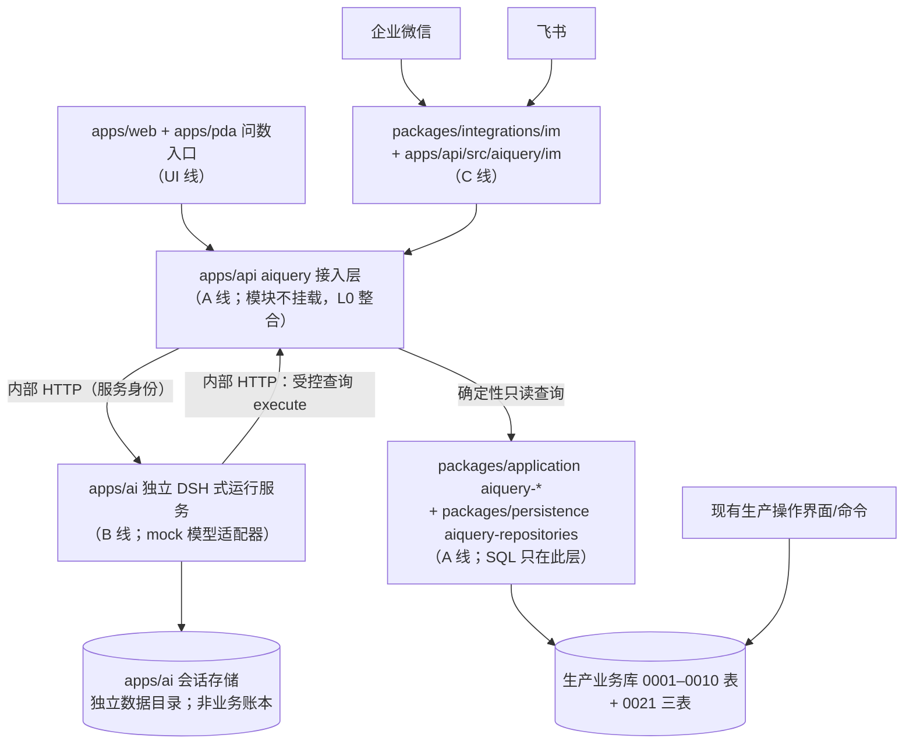

# P4 冻结合同 — AI 问数总体架构（三层拓扑与进程边界）

版本：P4 冻结合同候选 v1｜2026-10-28｜WorkItem：P4 文档合同冻结（AI 问数·DSH 路数）（RunKit WorkItem 编号与 PM assignment **待补绑**——Owner 2026-10-28 经 P4 分线授权派发，如实标注）
状态：**待 PM 签发**。标记约定同 `frozen/p1/org-auth.md`：本批为全新模块，**[合同新造]** 规则在 PM 签发前不视为已接受。

**溯源标记**：（方案 §x）= `/Users/yeemio/AI/gitrep/Cadence/architecture/ai-query-dsh-proposal.md`（Owner 指定路数基准，逐节对照）；（LP）= `delivery/coordination/P4-LANE-PACKAGES-20261028.md`（四线 owned paths／迁移号 0021／P4 红线）；（OA-xx/IT-xx/IF-xx）= `frozen/p1/` 对应冻结合同条款；（P2 包 §n）= `delivery/coordination/P2-LANE-PACKAGES-20261028.md` 共同协议第 n 条；（GAP-Pxx）= `frozen/p4/GAP-P.md`；仓内真实文件直接写路径＋符号名（可抽查核对）。Cadence 参考方案与本仓实况冲突处以本仓实况为准，差异登记 GAP-P7。

**线归属标记**：A=P4-A 受控问数查询层；B=P4-B AI 运行服务（DSH 路数）；C=P4-C IM 渠道；UI=P4-UI 问数入口；L0=整合协调（不属于任何实施线，仅登记整合动作）。

## 1. 总拓扑与三层职责

| 编号 | 规则（可判定） | 归属 |
| --- | --- | --- |
| AR-01 | 三层职责固定：**接入层**（apps/api/src/aiquery/**，A 线）负责可信身份、会话归属（ai_session）、能力/权限服务端重验、受控查询执行、审计落库与结果发送前检查；**AI 运行服务**（apps/ai/**，B 线）负责会话编排、模型调用（mock）、工具调用循环、澄清交互、超时/限额/取消；**受控查询层**（packages/application/src/aiquery-*.ts + packages/persistence/src/aiquery-repositories.ts，A 线）负责确定性业务查询与口径计算。三层不得互相越位：B 不得直接读生产库，A 不得调用模型，UI 不得绕过接入层直连 apps/ai。 | 方案 §3/§4；LP 线路表 |
| AR-02 | 接入层模块（apps/api/src/aiquery/**，含 C 线 im 子模块）在本线交付内**不挂载** app.module.ts、不改任何共享文件（P2 包 §2 零共享规则）；supertest 自组装取证；挂载、0021 注册、contracts/src/aiquery.ts 桶导出均由 L0 整合完成。 | LP；P2 包 §2 |
| AR-03 | apps/ai 是独立进程、独立部署组合件：不 import apps/api，不挂入 AppModule；由自己的入口启动（进程名/端口/健康检查独立）。web/PDA 问数与 IM 渠道消息一律经接入层转发进入 apps/ai，终端不直连 apps/ai 端口。 | 方案 §3/§4（apps/ai 职责行） |
| AR-04 | UI 入口（UI 线）只消费接入层的 HTTP 合同（contracts/src/aiquery.ts DTO）；结果卡片数字/来源/时间范围/完整性标注由结构化结果呈现，详情跳转走既有业务页面路由并**继续走 OA 鉴权**（链接可分享不等于可见，OA-25 同则）。 | 方案 §4（product-ui 行）、§5 第 5 条 |
| AR-05 | Cadence 参考方案的 `apps/server`/`packages/engine-reporting`/`packages/business-store`/既有 `integration-im` 在本仓均不存在：接入层落位 `apps/api`，确定性查询直建 `packages/application`/`packages/persistence` 读面（复用 domain 既有口径函数），`packages/integrations/im`、`packages/integrations/dsh` 均为 P4 全新开工包。差异清单登记 GAP-P7，不因参考方案命名扩权。 | 本仓实况；GAP-P7 |

## 2. 进程与运行边界（分离五件套）

| 编号 | 规则（可判定） | 归属 |
| --- | --- | --- |
| AR-06 | **进程分离**：apps/api（生产业务进程）与 apps/ai（AI 运行进程）必须可各自独立启动/停止。验收证据：停止 apps/ai 进程后，报工、质检、库存等生产操作命令与 `GET /health`（apps/api/src/health/health.controller.ts）行为不变。 | 方案 §3；LP P4 红线 |
| AR-07 | **运行身份分离**：两进程以不同运行身份/凭据运行；apps/ai 进程的环境凭据中不得出现生产数据库连接串（连接池仅存在于 apps/api 侧 db.module）。 | 方案 §3 |
| AR-08 | **数据目录分离**：apps/ai 的会话存储/运行记录写入自己的数据目录（部署配置指定），不得挂载生产业务数据目录；apps/api 不读 apps/ai 会话存储。 | 方案 §3/§7 |
| AR-09 | **资源限额分离**：apps/ai 配置独立的最大内存/并发/调用次数/单轮预算（按租户维度配置），超限拒绝新请求并返回可理解状态；限额配置不作用于 apps/api 生产路径。 | 方案 §7 |
| AR-10 | **网络边界**：apps/ai 对生产库无账号、不执行 SQL（AR-R2）；其唯一取数通道是接入层内部受控查询接口（dsh-edge.md §4 形状），该接口以部署内部服务凭据认证，不出公网；模型外发数据须在查询授权之后、按模型使用策略裁剪。 | 方案 §3/§6；LP 红线 |

## 3. 故障隔离与降级

| 编号 | 规则（可判定） | 归属 |
| --- | --- | --- |
| AR-11 | apps/ai 停机、超限或重启时：生产操作（命令链）、生产查询页、`GET /health` 均不受影响；问数入口（web/PDA/IM）显示**「AI 问数暂不可用」**（含原因类别：unreachable／over_limit／starting），不静默空白、不超时悬挂。UI 线提供该降级态；接入层提供探测接口（dsh-edge.md §5 health）。 | 方案 §3；LP 红线 |
| AR-12 | 接入层对 apps/ai 的每次转发设超时上限；超时按失败态回 UI/IM（可理解状态），不重试放大（IM 侧按 im-channels.md 重试合同处理同一处理记录）。 | 方案 §7 |
| AR-13 | AI 限额触发、进程重启、会话存储损坏不得改变生产事务或队列：AI 侧无任何生产写路径（AR-R1），生产侧不依赖 AI 组件完成任何业务流程。 | 方案 §7 |
| AR-14 | 接入层自身故障（如 0021 表不可用）时：生产路径同 AR-06 不受影响；问数入口按「暂不可用」降级；已在途的 apps/ai 工具调用得到明确错误（failed），不得把失败包装成「成功无记录」。 | **[合同新造]**（方案 §7 故障语义补全） |

## 4. requestId 审计链

| 编号 | 规则（可判定） | 归属 |
| --- | --- | --- |
| AR-15 | 每个用户提问轮（turn）由接入层生成全局唯一 `requestId`（UUID），贯穿：ai_session 绑定记录 → apps/ai 会话与工具调用记录 → 每次受控查询 execute（携带 requestId + toolCallSeq）→ ai_query_audit 落库 → 回答发送结果。任一环节缺 requestId 视为合同违约（测试断言位）。 | 方案 §5（审计关联） |
| AR-16 | 审计记录必要信息：用户请求（渠道/会话归属）、能力与版本、查询参数、结果状态、行数/截断、用量与耗时；模型/插件版本照实记录；**用量未知须标记 unknown，不估数**。敏感载荷按保留规则处理，不默认永久复制业务数据。 | 方案 §5/§7 |
| AR-17 | requestId 与会话/工具链日志在 apps/ai 侧保留（其数据目录），ai_query_audit（生产库）只落审计锚点与结果状态，不落完整聊天内容——两处以 requestId 关联。 | 方案 §7；AQ-S3 |

## 5. 会话存储与业务账本分离

| 编号 | 规则（可判定） | 归属 |
| --- | --- | --- |
| AR-18 | DSH 会话存储（apps/ai 数据目录）保存交互与执行记录；**AI 历史不是库存/状态/工时/财务账本**：任何业务事实问题必须经能力查询取当前读面，禁止用会话历史或文档检索替代动态事实作答。 | 方案 §7；LP 红线 |
| AR-19 | 生产库 0021 `ai_session` 表只保存**会话身份绑定与审计锚点**（谁、哪个渠道、哪个会话目标、起止状态，AQ-S3），不是聊天记录表；业务数据库不随每次 AI 轮次复制消息正文。 | 方案 §7；AQ-S3 |
| AR-20 | 会话/工具执行成功只表示 AI 执行状态：**不创建生产事实、不构成业务审批**（放行/报工/扣库存等仍只能走既有命令链，AI 无命令面）。 | 方案 §2 第 4 条/§7；LP 红线 |

## 6. P4 红线（逐条成文）

| 编号 | 红线 | 落位 |
| --- | --- | --- |
| AR-R1 | **AI 只读**：不装配任何生产写能力；能力注册表（AQ-REG）只登记只读查询能力；AI 会话内不存在命令工具；后续如出现"操作意图"，只能提示走既有业务命令与审批，不在本合同范围。 | capability-contract.md AQ-REG-02 |
| AR-R2 | **AI 服务无生产数据库账号、不执行 SQL**：SQL 只存在于 A 线 persistence 读面；apps/ai 仅经内部受控 HTTP 取数。 | AR-07/AR-10；dsh-edge.md DS-04 |
| AR-R3 | **每次查询服务端重验**：身份、能力、对象范围、可返回字段在每次 execute 由接入层按 OA 会话+企业/工厂范围合同重算（不信任 ai_session 快照、不信任模型参数）；AI 只能缩小授权范围。 | capability-contract.md AQ-AUTH-01～04 |
| AR-R4 | **会话/工具成功≠生产事实、不构成业务审批**。 | AR-20 |
| AR-R5 | **AI 历史≠库存/状态/工时/财务账本**。 | AR-18 |
| AR-R6 | **真实付费模型与企业凭据不接通**：mock 模型适配器与 mock 渠道承载全部合同行为；真实 DSH 版本、真实模型调用、企微/飞书企业应用凭据均为 SITE_PENDING（GAP-P1～P3），不自动接通、不产生付费调用。 | dsh-edge.md DS-12～14；im-channels.md IM-14 |

## 7. L0 整合边界（登记，非实施线任务）

| 编号 | 动作 | 归属 |
| --- | --- | --- |
| AR-21 | 0021 迁移注册进 registry.ts（先例：P1 各波）；aiquery 模块挂载 app.module.ts；contracts/src/aiquery.ts 并入 contracts 桶导出。 | L0 |
| AR-22 | B↔A 内部接口接通（B 线 mock 客户端替换为真实 HTTP；A 线 execute 端点生效）；C→接入层 im 子模块挂载。 | L0 |
| AR-23 | apps/ai 进程纳入部署组合（进程清单/运行身份/数据目录/限额配置项随交付说明登记）。 | L0 |

## 8. 分线验收门（引用，不重定义六门）

- 各线 Done-when 按 LP 共同协议（P2 包 §5 六门 + 本线 supertest/integration 证据 + DELIVERY + SHA256-MANIFEST）执行，本文只列**架构级增量验收**：
  - A：三能力 execute 在约定数据/口径下与业务页面/查询结果对得上（逐能力对照样例）；歧义/无权限/未就绪/截断/失败五类状态分别可见（LP P4-A 行）。
  - B：停 apps/ai 后生产操作与 `/health` 不受影响的故障隔离证明；取消/超时后停止继续调工具的状态证明（LP P4-B 行）。
  - C：mock 双向消息、去重、发送未知态、群引导语的可复现证据（LP P4-C 行）。
  - UI：问数页提问/澄清/结果卡片（数字+来源+时间范围+完整性+详情跳转再鉴权）与 AI 不可用态（LP P4-UI 行）。

## 9. 开放项引用（不生效，待裁定/输入）

- GAP-P1～P11 全清单见 `frozen/p4/GAP-P.md`（真实 DSH/凭据/付费模型、上游读面未接问法、敏感域、受限内容、参考方案差异、渠道持久化承载、execution_status 无置位路径、SaaS 共享进程隔离、时间基准约定）。

— 规则统计：AR-01～AR-23 共 23 条架构规则 ＋ AR-R1～AR-R6 共 6 条红线成文。
